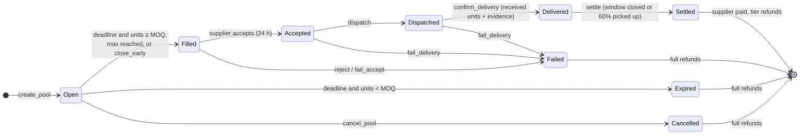
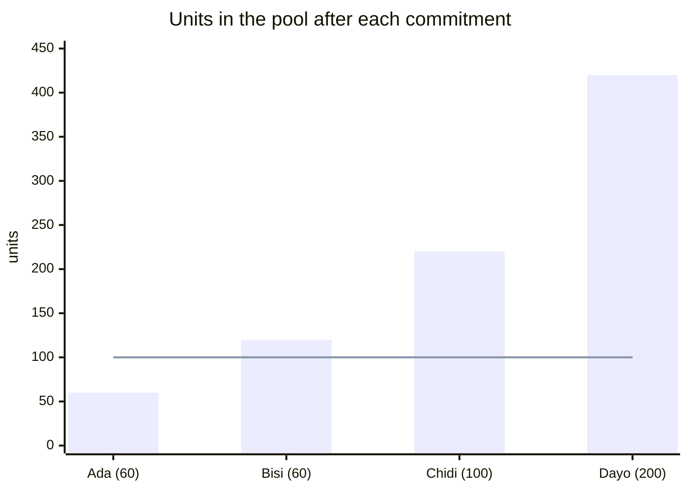
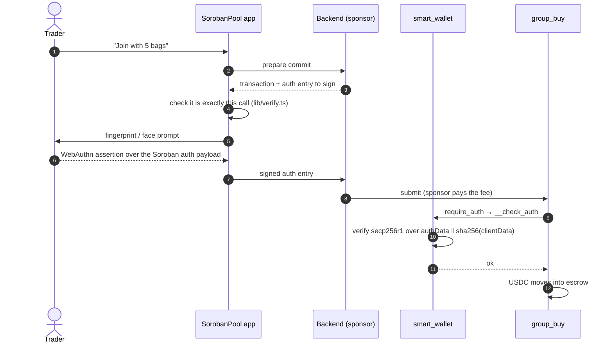

# sorobanpool-contracts

**Buy together. Pay on delivery.** Soroban smart contracts for SorobanPool, a group-buying app for market traders in Nigeria. Built on Stellar.

[](https://github.com/SorobanPool/sorobanpool-contracts/actions/workflows/ci.yml)


> Testnet only. The contracts are not audited yet; do not use them on mainnet.

Small traders (provisions, foodstuff, fabric, phone accessories) cannot reach a supplier's minimum order on their own, so they buy from middlemen at near-retail prices. Informal group buying exists, but it runs on trust: the person collecting the cash can disappear, short-deliver or mark up. SorobanPool replaces that person with an escrow contract:

- traders **commit money into escrow**, not to a person;
- the more units the group orders, the **lower the unit price**, and everyone gets the better price automatically;
- the supplier is paid **only after delivery is confirmed**, minus fees;
- if the group does not reach the minimum order, or the supplier does not deliver, **everyone is refunded**, and anyone can trigger it.

Repos: **contracts** (this one) · [backend](https://github.com/SorobanPool/sorobanpool-backend) · [frontend](https://github.com/SorobanPool/sorobanpool-frontend). The product and architecture brief: [docs/brief.md](docs/brief.md).

---

## How the contracts fit together

```mermaid
flowchart LR
    subgraph user["A trader's phone"]
        PK["🔐 Passkey<br/>(fingerprint / face)"]
    end
    W["smart_wallet<br/><i>one per user</i>"]
    GB["group_buy<br/>pools · escrow · settlement · refunds"]
    D["disputes<br/>deposits · arbiter · SLA timeout"]
    R["reputation<br/>counters · tiers"]
    B["supplier_bond<br/>bonds · advances · slashing"]
    REG["registry<br/>roles · verification hashes"]
    C["config<br/>params & hard caps · pause · addresses<br/>attestors · arbiters · categories"]
    USDC[("USDC<br/>Stellar Asset Contract")]

    PK -- "WebAuthn assertion" --> W
    W -- "authorises commit / confirm / claim" --> GB
    GB <-- "freeze / apply_outcome" --> D
    GB -- "record" --> R
    D -- "record" --> R
    GB -- "reserve / release / slash" --> B
    GB -- "status / level / suspend" --> REG
    GB <-- "transfer" --> USDC
    C -. "read by every contract" .- GB
    C -. "" .- D
    C -. "" .- REG
```

| Contract | Responsibility | Who may call privileged functions |
|---|---|---|
| `config` | Parameters (within hard caps), pause scopes, sibling addresses, attestors, arbiters, category allow-list | admin (multisig on mainnet); guardian may pause |
| `registry` | Trader / organizer / supplier status and verification level. **No personal data**, only salted hashes | attestors, admin, `group_buy` / `disputes` (suspend) |
| `group_buy` | Pool state machine, commitments, escrow, shortfall allocation, settlement, refunds | `disputes` only, for `freeze` / `apply_outcome` |
| `disputes` | Disputes, deposits, arbiter resolution, permissionless SLA timeout | arbiters (`resolve`) |
| `supplier_bond` | Supplier bonds that back optional advances; slashed on failure | `group_buy` |
| `reputation` | Counters and tiers (S0–S3, O0–O2, T0–T2) that set pool-size and spend limits | `group_buy`, `disputes` |
| `smart_wallet` | Each user's account, controlled by their passkey ([ADR 0006](docs/decisions/0006-passkey-smart-wallet.md)) | the account itself |

## A pool's life



- **Every exit is permissionless and time-checked.** `close`, `fail_accept`, `fail_delivery`, `settle`, `disputes.timeout` and refunds never depend on SorobanPool's servers. Pausing never blocks them.
- **Disputes freeze only the claimed amount.** The rest of the pool settles normally, and an arbiter who misses the SLA loses the case to the disputer.
- Every transition, who may call it and its preconditions: [docs/state-machine.md](docs/state-machine.md).

## How pricing works (worked example)

A supplier offers rice with three price tiers. Each trader pays the **ceiling price**: the price of the tier the pool is in *before* their units. That guarantees escrow always covers the final bill. When the pool closes at a better tier, the difference comes back.

| Tier | From (units) | Price per unit |
|---|---|---|
| 1 (MOQ) | 100 | 1.00 USDC |
| 2 | 200 | 0.90 USDC |
| 3 | 400 | 0.80 USDC |



| Trader | Units | Pool before | Pays now | Final price (420 units, tier 3) | Refund |
|---|---|---|---|---|---|
| Ada | 60 | 0 | 60 × 1.00 = **60.00** | 48.00 | **12.00** |
| Bisi | 60 | 60 | 60 × 1.00 = **60.00** | 48.00 | **12.00** |
| Chidi | 100 | 120 | 100 × 1.00 = **100.00** | 80.00 | **20.00** |
| Dayo | 200 | 220 | 200 × 0.90 = **180.00** | 160.00 | **20.00** |
| **Total** | **420** | | **400.00** in escrow | **336.00** owed | **64.00** back |

On settlement the supplier receives 336.00 minus the 1.5% platform fee = **330.96 USDC**, and the 64.00 goes back to the traders. If only 400 bags arrive, the shortfall is shared out pro rata, deterministically, and the supplier is paid only for what arrived. More examples, including shortfall and disputes: [docs/pricing-math.md](docs/pricing-math.md). 600 generated vectors in [vectors/pricing-vectors.json](vectors/pricing-vectors.json) keep the backend and frontend maths identical to the contract's.

## Passkey wallets: no seed phrase, no gas



The passkey's private key never leaves the phone's secure hardware, and the trader never holds XLM. Signature verification is OpenZeppelin's audited `stellar_accounts::verifiers::webauthn::verify`.

## Safety properties, and how they are tested

| Property | Where it is checked |
|---|---|
| Escrow always covers the final bill after any commit or allowed withdrawal | property tests, `crates/scenarios/tests/suite/properties.rs` |
| Tokens are conserved: refunds + payouts + fees = total paid | proptest plus randomised operation-sequence fuzzing (`fuzz.rs`) |
| No member pays more than `units × tier-1 price`; price never rises as units grow | property tests |
| One dispute per party per pool, so the same units cannot be re-claimed | `hardening.rs` |
| Two supplier failures in 90 days suspend the supplier | `hardening.rs` |
| `commit`, `settle`, `claim_refund` stay under 50% of network limits at 200 members; `push_refunds(25)` under 80% | `budget.rs` |
| Only a valid, user-verified passkey assertion over the exact payload authorises a wallet | `contracts/smart_wallet/src/test.rs` (real ES256 signatures) |

CI gates: `cargo fmt`, `clippy -D warnings`, 77 tests, wasm build, TypeScript bindings freshness, exported `errors.json` / `events.json` checked against the docs, and **≥ 90% line coverage** on `group_buy`, `disputes` and `supplier_bond`. The threat model covers collusion, sybils, arbiter capture, griefing and FX movement: [docs/threat-model.md](docs/threat-model.md).

## Quickstart

Needs Rust (pinned by `rust-toolchain.toml`, target `wasm32v1-none`) and the [Stellar CLI](https://developers.stellar.org/docs/tools/cli) 28.

```bash
cargo fmt --all && cargo clippy --workspace --all-targets -- -D warnings
cargo test --workspace            # 77 tests: unit, scenario, property, fuzz, budget
stellar contract build            # wasm in target/wasm32v1-none/release
scripts/bindings.sh               # TypeScript bindings into bindings/
python3 scripts/export_artifacts.py   # errors.json / events.json, cross-checked against docs
```

Deploy your own copy to testnet:

```bash
stellar keys generate sorobanpool-deployer --network testnet --fund
NETWORK=testnet scripts/deploy.sh     # deploys, wires (init.sh), writes deployments/testnet.json
```

Mainnet deploys refuse to run without `MAINNET_CONFIRM=yes`, a clean tree, a release tag, an audit report hash and the admin multisig.

## Repository map

```text
contracts/      config · registry · reputation · supplier_bond · group_buy · disputes · smart_wallet
crates/
  sp_common/    shared types, errors, tier & pro-rata maths, cross-contract client traits, TTL helpers
  scenarios/    every contract wired together with a real token: scenario, property, fuzz, budget tests
bindings/       generated TypeScript clients (CI fails when stale)
artifacts/      errors.json, events.json (consumed by the backend indexer and the frontend error map)
deployments/    testnet.json / mainnet.json: contract ids, wasm hashes, source commit
vectors/        pricing-vectors.json (cross-repo parity)
docs/           state machine, pricing maths, events, errors, storage & TTL, threat model, decisions (ADRs)
scripts/        build, deploy (guarded), init, bindings, artefact export
```

## Contributing

Good places to start: test vectors and property tests, docs and worked examples, threat-model review, and gas or footprint reductions with a budget test that proves them. Escrow maths, settlement, disputes, bonds and the wallet are security-sensitive: changes there need two maintainer reviews and a test that fails without the change. See [CONTRIBUTING.md](CONTRIBUTING.md) and [SECURITY.md](SECURITY.md); please report vulnerabilities privately.

## Status

| | |
|---|---|
| ✅ Done | All seven contracts, full state machine, shortfall, disputes, bonds/advances (disabled by default), reputation tiers, passkey wallet, testnet deployment, bindings and artefacts |
| ⏳ Before mainnet | External audit (smart_wallet in scope), admin multisig, coverage-guided fuzzing, wallet recovery when every passkey is lost, SDF brand consent for the name. Full list: [docs/mainnet-checklist.md](docs/mainnet-checklist.md) |

Licensed under Apache-2.0.
